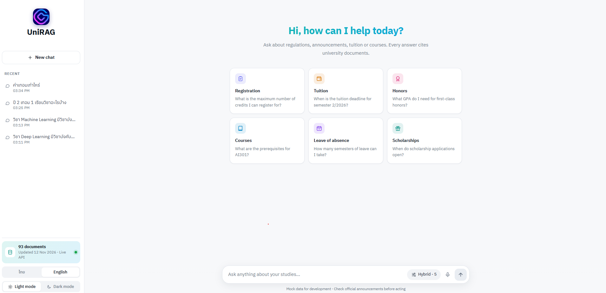

# 06-ProJ: AI smart university assistant

A Thai/English multi-agent RAG chat assistant for university students. It answers questions about the **B.Eng. Computer Engineering curriculum (RMUTT, revised 2568)**, registration, tuition and scholarships, and **every answer cites its source documents**. The AI parts use **Python + PyTorch** and run locally.

## Structure

```text
01_web_app/                 # Frontend (Next.js) — chat UI
02_api_backend/             # FastAPI gateway (main.py)
03_ai_router_agent/         # Router: safety → classifier → Thai keyword fallback → clarify
04_ai_model_selection/      # Engines + local PyTorch models (train_local_ai.py, models/)
05_retrieval_knowledge/     # Knowledge base, ingestion, hybrid retrieval
06_llm_generation/          # Answer, citations, safety
07_response_logging/        # Response format, history, feedback (SQLite)
08_monitoring_deployment/   # /metrics, evaluation gate (evaluate.py)
09_backend/                 # Shared code, run scripts, tests, .env
web_app_std.bat             # Start / stop the whole system

```

Each stage folder also has `01_env.txt`, `02_step.txt` and `03_process.txt` (requirements, workflow, techniques).

----
## How to Run

Requirements: Python 3.10+, PyTorch (CUDA optional), Node.js 20+, ~5 GB disk for the Hugging Face models.

```bash
pip install -r 09_backend/requirements.txt
cd 01_web_app/frontend && npm install && cd ../..
```

```bat
web_app_std.bat          :: first run builds the knowledge base + trains models, then opens http://localhost:3000
web_app_std.bat stop     :: stop the system
09_backend\run_backend.bat test   :: tests + evaluation (stop the system first)
```

**API key (optional):** open `09_backend/.env`, paste your key into
`### OPENAI_API_KEY=...`, remove `### `, then restart. Without a key, answers are taken directly from the documents.




----
## Evaluation

| Metric | Result | Target |
|---|---|---|
| Router accuracy | 1.00 | ≥ 0.90 |
| Retrieval Recall@5 | 0.95 | ≥ 0.85 |
| Citation accuracy | 0.98 | ≥ 0.90 |
| Faithfulness | 0.98 | ≥ 0.85 |

Test sets are still small (42 router / 23 retrieval questions), so results are optimistic.

----
## Data Sources

- Curriculum: [thanasinb/CPE_RMUTT68](https://github.com/thanasinb/CPE_RMUTT68) — no license file, so the raw copy is
  not committed (clone it as above).
- Regulations/announcements in `kb_docs.json` are **fictional samples**; the risk model uses **synthetic** data.
- Models: [BAAI/bge-m3](https://huggingface.co/BAAI/bge-m3), [BAAI/bge-reranker-v2-m3](https://huggingface.co/BAAI/bge-reranker-v2-m3); Thai NLP: [PyThaiNLP](https://github.com/PyThaiNLP/pythainlp)


