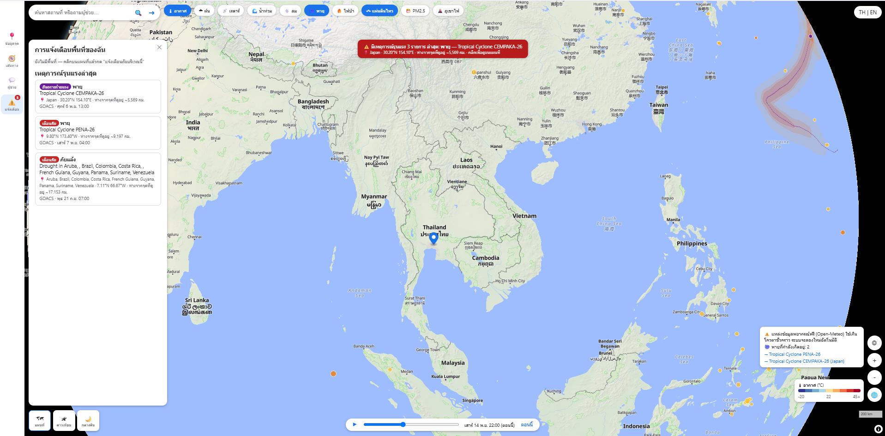

# 07-ProJ: AI smart travel & emergency assistant

A Thai/English travel-safety assistant with a **global hazard map**. The map opens as a 3D globe and zooms down to a street map. It shows **weather, rain, wind, storms, floods, wildfires, earthquakes and PM2.5** with a 72-hour forecast timeline. You can plan a trip and get **one clear recommendation**: travel normally, change route, delay, or avoid. Every answer shows its reasons, sources and data freshness. All data comes from **free public APIs**. An optional free **Llama API** helps understand Thai/English questions. Safety decisions always come from tested rules, never from the LLM.

## Structure

```text
01_web_app/                    # Web page (HTML/CSS/JS + MapLibre GL): globe/map, layers, timeline, trip, chat, alerts
02_api_/                       # FastAPI gateway — the only API the web page calls (api_server.py)
03_travel_ai_agent/            # Agent: understand the request (rules + optional Llama) → call modules 04–08 in order
04_external_data_services/     # Free API adapters: Open-Meteo, USGS, GDACS, NASA EONET, RainViewer, OSRM, Nominatim
05_data_integration/           # Clean/combine data, route sampling, de-duplication, snapshots, map forecast grid
06_risk_knowledge_services/    # Hazard thresholds, route risk at arrival time, Disaster RAG (knowledge/*.md)
07_decision_llm_engine/        # Decision rules (one action, locked) + explanation (template or verified Llama answer)
08_recommendation_feedback/    # Final response, feedback, area alerts + alert watcher (SQLite)
09_backend/                    # Shared code, run_all.py launcher, tests, docker-compose (prepared), .env.example
web_agent_predic.bat           # Start the whole system in one window
proj-prompt.txt                # Full project specification (modules 01–09 + appendices)
```

Each stage folder also has `01_env.txt`, `02_step.txt` and `03_process.txt` (requirements, workflow, techniques).

----
## How to Run

```bash
git clone https://github.com/aproot-en/Advanced-Topic-in-Computer-Software-Course.git
cd "Advanced-Topic-in-Computer-Software-Course/DL-07: Agentic AI System II"
```

```bat
web_agent_predic.bat     :: first run creates .venv and installs packages, then starts all services
                         :: and opens http://127.0.0.1:3000 — press Ctrl+C or close the window to stop
.venv\Scripts\python.exe -m pytest 09_backend\tests -q             :: tests
.venv\Scripts\python.exe 09_backend\scripts\check_health.py         :: which services are running
```

**Llama API key (optional, free):** create a key at [console.groq.com](https://console.groq.com) and make a file `.env` in the project root with
`LLM_API_KEY=...` (see `09_backend/.env.example`), then restart. Without a key, the system uses rules and templates only.



----
## Tests

| Test file | What it checks | Tests |
|---|---|---|
| `test_rules.py` | Severity thresholds, route risk at arrival time, decision rules, Thai/English request parsing, Llama answer checks | 21 |
| `test_modules.py` | Data integration, Disaster RAG, LLM answer verification, recommendation builder, SQLite storage | 14 |
| `test_bugfixes.py` | One test per fixed bug (forecast range, storm tracks, retries, Nominatim rate limit, cache size, DB connections) | 10 |
| `test_quota.py` | Careful use of the free forecast quota (per-point cache, HTTP 429 pause, backup data) | 5 |
| `test_run_all.py` | One-window launcher (log filter, port check) | 4 |
| `test_end_to_end.py` | Whole flow 02 → 08 in one process with the real free APIs (needs internet and free quota) | 8 |

The 54 offline tests pass. The 8 end-to-end tests call the real APIs and fail while the Open-Meteo hourly quota is used up. The rules are tested with small, hand-made scenarios, so the tests do not prove the system is accurate in real conditions.

----
## Data Sources

- Weather, rain, wind, PM2.5, river discharge, place search: [Open-Meteo](https://open-meteo.com) — free for non-commercial use (CC BY 4.0). It has hourly/daily limits; when the limit is reached the map shows a message and retries.
- Earthquakes: [USGS Earthquake Hazards Program](https://earthquake.usgs.gov) (public domain).
- Storms, floods, wildfires, volcanoes, droughts: [GDACS](https://www.gdacs.org) and [NASA EONET](https://eonet.gsfc.nasa.gov).
- Rain radar: [RainViewer](https://www.rainviewer.com). Routing: [OSRM demo server](https://project-osrm.org). Geocoding and nearby hospitals: [Nominatim](https://nominatim.org) (max 1 request/second) — map data © [OpenStreetMap](https://www.openstreetmap.org/copyright) contributors (ODbL).
- Basemaps: [OpenFreeMap](https://openfreemap.org) (OpenMapTiles / OpenStreetMap) and Esri World Imagery for the satellite view.
- Optional LLM: Llama models through the [Groq](https://groq.com) free tier.
- Safety guidance in `06_risk_knowledge_services/knowledge/` is a **general summary written for this project**. The severity thresholds and emergency numbers are **defaults**. Check them against official sources (TMD, DDPM, Pollution Control Department) before real use.
- Earthquakes cannot be predicted: the system only shows official events, estimated shaking and statistical aftershock probabilities.

